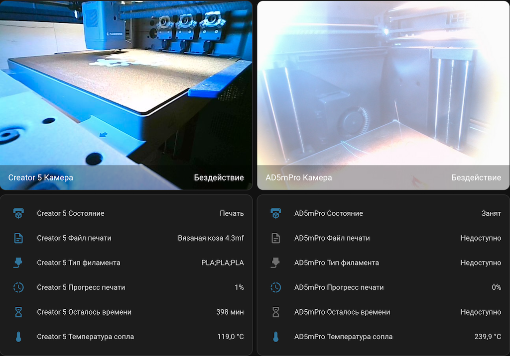

# FlashForge 3D Printer — интеграция для Home Assistant

Пользовательская интеграция для 3D-принтеров FlashForge (Adventurer 5M / 5M Pro, AD5X, Creator 5 / Creator 5 Pro).
Работает локально, без облака: опрос состояния, управление печатью и видеопоток с камеры принтера.



## Возможности

**Показания датчиков и прогресс печати**

| Сущность | Тип | Описание |
| --- | --- | --- |
| `sensor.status` | enum | Состояние принтера: `ready`, `printing`, `paused`, `error`, … |
| `sensor.print_progress` | % | Прогресс текущей печати |
| `sensor.current_layer` / `sensor.total_layers` | число | Текущий и общий слой |
| `sensor.remaining_time` | мин | Осталось времени по оценке прошивки |
| `sensor.estimated_finish` | timestamp | Расчётное время окончания печати |
| `sensor.printing_file` | текст | Имя печатаемого файла |
| `sensor.nozzle_temperature` / `nozzle_target_temperature` | °C | Температура и цель сопла (модели с одним соплом) |
| `sensor.nozzle_<n>_temperature` / `nozzle_<n>_target_temperature` | °C | Температура и цель каждого сопла (многосопловые модели) |
| `sensor.bed_temperature` / `bed_target_temperature` | °C | Температура и цель стола |
| `sensor.chamber_temperature` | °C | Температура камеры (только модели с датчиком) |
| `sensor.filament_used_length` / `filament_used_weight` | м / г | Расход филамента на текущую печать |
| `sensor.total_print_time` / `total_filament_used` | ч / м | Накопленная статистика |
| `sensor.air_quality` | µg/m³ | TVOC |
| `binary_sensor.printing`, `paused`, `problem`, `door` | бинарные | Быстрые триггеры для автоматизаций |

**Сопла на многосопловых моделях (Creator 5 / Creator 5 Pro)**

Прошивка Creator 5 не заполняет поля `rightTemp` / `rightTargetTemp`, из которых
строится скалярное сопло, а отдаёт массивы `nozzleTemps` / `nozzleTargetTemps` —
по элементу на инструмент. Поэтому для таких моделей интеграция создаёт пару
сущностей на каждое сопло:

| Сущность | Тип | Описание |
| --- | --- | --- |
| `sensor.nozzle_1_temperature` | °C | Фактическая температура сопла №1 |
| `sensor.nozzle_1_target_temperature` | °C | Целевая температура сопла №1 |
| … | °C | Аналогично для остальных сопел |

Количество сущностей определяется по фактической длине массива температур от
прошивки, а не по флагу модели и не по полю `nozzleCnt`. Так исключаются две
ошибки: флаг модели вычисляется по имени принтера и ломается при переименовании,
а `nozzleCnt` может сообщать больше слотов, чем реально отдаёт прошивка, — тогда
часть сущностей навсегда осталась бы недоступной. На Creator 5 это даёт четыре
пары сущностей.

Скалярные `sensor.nozzle_temperature` и `sensor.nozzle_target_temperature`
показываются только когда принтер сообщает не более одного инструмента: на
многосопловых моделях они всегда отдавали бы пустое значение. Оба правила
опираются на один и тот же массив, поэтому всегда активен ровно один набор
сущностей. На моделях с одним соплом поведение не изменилось.

`unique_id` сущности привязан к порядковому номеру инструмента, поэтому история
и настройки сохраняются между перезапусками.

**Видеопоток с камеры**

Камера принтера (MJPEG, порт 8080) публикуется как стандартная сущность `camera`.
Поток отдаётся браузеру как есть, без перекодирования: интеграция не объявляет
`CameraEntityFeature.STREAM`, поэтому Home Assistant не запускает `ffmpeg` и не
превращает MJPEG в HLS. Задержка остаётся в пределах одного кадра, CPU не
расходуется на транскодирование.

Принтер обслуживает камеру одним потоком, поэтому интеграция держит ровно одно
соединение с ней: все зрители (живой просмотр, миниатюра на дашборде,
уведомления) получают кадры из общего читателя. Когда зрителей нет, соединение
закрывается по тайм-ауту простоя.

URL потока берётся из ответа `/detail`. Если прошивка его не сообщает, адрес
определяется однократной сетевой проверкой при настройке (кнопка «Обновить
видеопоток» повторяет её вручную). Неудачная проверка кэшируется на 10 минут,
чтобы не тормозить периодический опрос датчиков.

**Управление**

* `button.pause_print`, `button.resume_print`, `button.cancel_print`
* `button.clear_platform`, `button.home_axes`, `button.refresh_camera_stream`
* `switch.light` (модели с подсветкой), `switch.filtration`, `switch.camera`

## Установка

### HACS (как пользовательский репозиторий)

1. Настройки → Marketplace → **Пользовательские репозитории** (HACS → **Интеграции** → меню → **Пользовательские репозитории**).
2. Добавьте URL этого репозитория, категория — *Integration*.
3. Установите **FlashForge 3D Printer** и перезапустите Home Assistant.

### Вручную

Скопируйте каталог `custom_components/flashforge_ac5` в
`<конфигурация>/custom_components/flashforge_ac5` и перезапустите Home Assistant.

## Настройка

1. **Настройки → Устройства и службы → Добавить интеграцию → FlashForge 3D Printer**.
2. Заполните поля:
   * **Хост / IP-адрес** — адрес принтера в локальной сети;
   * **Серийный номер** — `Настройки → Сеть → Режим LAN` на экране принтера;
   * **Код проверки** — оттуда же (обычно 8 символов).
3. Дополнительные параметры доступны через **Настроить**: интервал опроса
   (5–300 с, по умолчанию 20 с) и смена кода проверки.

Кнопка **Изменить** позволяет сменить IP-адрес и учётные данные без удаления
интеграции — записи и история сущностей сохраняются.

## Требования

* Home Assistant 2026.1 или новее
* Принтер в режиме LAN, доступный из сети Home Assistant
* Python-пакет [`flashforge-python-api`](https://github.com/GhostTypes/ff-5mp-api-py) — устанавливается автоматически

## Как это устроено

```
custom_components/flashforge_ac5/
├── __init__.py       # setup/unload, runtime_data
├── api.py            # обёртка над flashforge-python-api, типизированные ошибки
├── coordinator.py    # DataUpdateCoordinator: один опрос — один согласованный снимок
├── models.py         # PrinterSnapshot
├── entity.py         # базовый класс: устройство, идентификаторы, доступность
├── config_flow.py    # первичная настройка, reconfigure и options
├── sensor.py         # показания и прогресс
├── binary_sensor.py  # печать, пауза, дверца, проблема
├── camera.py         # MJPEG без перекодирования: один общий читатель кадров
├── button.py         # команды печати и обслуживания
└── switch.py         # подсветка и фильтрация
```

Все сущности читают данные из одного `PrinterSnapshot`, поэтому прогресс,
номер слоя и время окончания в одном цикле опроса всегда согласованы между собой.
Сетевые сбои превращаются в `UpdateFailed` и помечают сущности недоступными,
не «замораживая» последние значения как актуальные.

## Устранение неполадок

* **«Принтер отклонил серийный номер или код проверки»** — сверьте значения в
  меню LAN принтера; после обновления прошивки код может измениться.
* **Сущности недоступны** — проверьте, что принтер включён и отвечает по HTTP на
  порт 8898; при смене IP используйте «Изменить».
* **Нет сущности камеры** — прошивка сообщает об отсутствии камеры; нажмите
  «Обновить видеопоток» после включения камеры на экране принтера.
* Отладочные сообщения: добавьте в `configuration.yaml`

  ```yaml
  logger:
    logs:
      custom_components.flashforge_ac5: debug
      flashforge: debug
  ```

## Лицензия

Код интеграции распространяется по лицензии MIT. Используемая библиотека
`flashforge-python-api` также распространяется по MIT.
